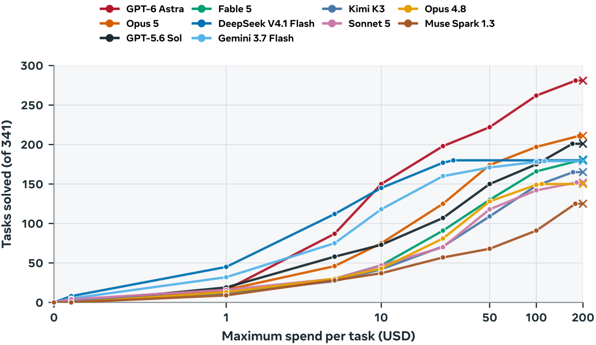
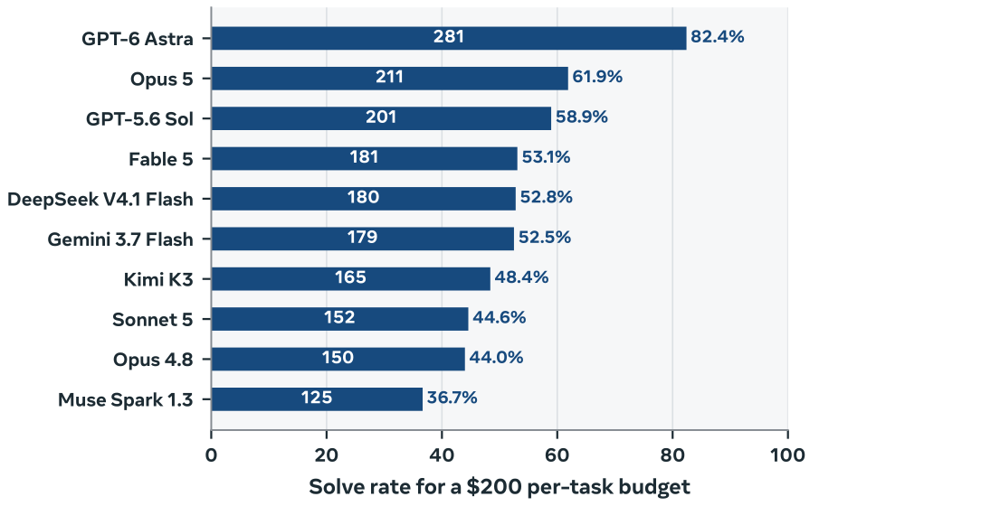

<!-- Copyright (c) Meta Platforms, Inc. and affiliates. -->

# AutoformBench

[](LICENSE)
[](https://lean-lang.org/)

AutoformBench is a benchmark for evaluating the formalization of mathematical
statements in Lean 4. This repository is the source-free **public release**: 241
audited problems, clean-room grading workspaces, a deterministic Harbor adapter,
and task-level leaderboard data.

The benchmark uses Lean `v4.32.2` and Mathlib commit
`905b95818eb32af7874a58b427f50c1711a5e96c`.

## Results at a glance

<p align="center">
  <a href="figures/budget_conditioned_cost_usd.pdf"></a>
</p>

<p align="center">
  <a href="figures/model_capability.pdf"></a>
</p>

Performance and cost efficiency on the full 341-task benchmark. Select either
figure to open its vector PDF.

## Leaderboard

The official ranking uses the full frozen **341-task** benchmark in the paper's
source-present evaluation condition. Public and private aggregate scores are
shown to make the split auditable; the linked task-level CSVs contain only the
241 public tasks and do not disclose holdout membership or per-task outcomes.

<!-- leaderboard:start -->
| Rank | Model | Full benchmark | Public | Private | Public results |
| ---: | --- | ---: | ---: | ---: | --- |
| 1 | GPT-6 Astra | 281 / 341 (82.4%) | 199 / 241 (82.6%) | 82 / 100 (82.0%) | [CSV](leaderboard_data/gpt-6-astra.csv) |
| 2 | Opus 5 | 211 / 341 (61.9%) | 150 / 241 (62.2%) | 61 / 100 (61.0%) | [CSV](leaderboard_data/opus-5.csv) |
| 3 | GPT-5.6 Sol | 201 / 341 (58.9%) | 142 / 241 (58.9%) | 59 / 100 (59.0%) | [CSV](leaderboard_data/gpt-5.6-sol.csv) |
| 4 | Fable 5 | 181 / 341 (53.1%) | 128 / 241 (53.1%) | 53 / 100 (53.0%) | [CSV](leaderboard_data/fable-5.csv) |
| 5 | DeepSeek V4.1 Flash | 180 / 341 (52.8%) | 128 / 241 (53.1%) | 52 / 100 (52.0%) | [CSV](leaderboard_data/deepseek-v4.1-flash.csv) |
| 6 | Gemini 3.7 Flash | 179 / 341 (52.5%) | 126 / 241 (52.3%) | 53 / 100 (53.0%) | [CSV](leaderboard_data/gemini-3.7-flash.csv) |
| 7 | Kimi K3 | 165 / 341 (48.4%) | 117 / 241 (48.5%) | 48 / 100 (48.0%) | [CSV](leaderboard_data/kimi-k3.csv) |
| 8 | Sonnet 5 | 152 / 341 (44.6%) | 108 / 241 (44.8%) | 44 / 100 (44.0%) | [CSV](leaderboard_data/sonnet-5.csv) |
| 9 | Opus 4.8 | 150 / 341 (44.0%) | 106 / 241 (44.0%) | 44 / 100 (44.0%) | [CSV](leaderboard_data/opus-4.8.csv) |
| 10 | Muse Spark 1.3 | 125 / 341 (36.7%) | 89 / 241 (36.9%) | 36 / 100 (36.0%) | [CSV](leaderboard_data/muse-spark-1.3.csv) |
<!-- leaderboard:end -->

Only aggregate statistics for the private holdout are published. Pass rates
should be compared together with each run's model, agent scaffold, source
access, tool access, token budget, and stopping policy. The public CSV files
preserve the reported token, cost, turn, and code-size measurements for
reproducible analysis; the source excerpts used in those evaluations are not
redistributed here.

## Public/private split

AutoformBench contains 341 audited tasks. This repository includes the 241-task
public split; the remaining 100 tasks are held privately for evaluation. Public
task IDs are listed in [`MANIFEST.csv`](MANIFEST.csv).

## Repository contents

| Path | Contents |
| --- | --- |
| [`workspaces/`](workspaces/) | 241 canonical Lean grading workspaces |
| [`MANIFEST.csv`](MANIFEST.csv) | Problem IDs, source groups, and graded declarations |
| [`SOURCES.csv`](SOURCES.csv) | Bibliographic metadata and public source URLs |
| [`leaderboard_data/`](leaderboard_data/) | Public task-level evaluation outcomes |
| [`harbor/`](harbor/) | Deterministic Harbor 0.22 adapter and verifier images |

This release contains no textbook excerpts, PDFs, informal source files, model
traces, accepted submissions, gold proofs, or internal audit records. Source
material can be obtained independently through the public references in
[`SOURCES.csv`](SOURCES.csv).

## Use a workspace directly

Each workspace contains a trusted challenge, a submission skeleton, and a
clean-room grader. Pick an ID from `MANIFEST.csv`, then:

```bash
cd workspaces/<problem_id>
lake exe cache get
# Replace the target `sorry` declarations in Submission.lean.
lake test
```

Auxiliary Lean code may be added under `Submission/`. A passing submission must
match the challenge statement, use only permitted axioms, pass Comparator, and
survive independent-kernel replay.

## Use with Harbor

Generate the Harbor task view and validate the release:

```bash
make harbor-tasks
make check
```

The generated `harbor/tasks/` directory is intentionally not tracked. See the
[Harbor guide](harbor/README.md) for image construction and runner commands.

## Citation

Please cite AutoformBench using [`CITATION.cff`](CITATION.cff). Bibliographic
details for the mathematical sources are retained in `SOURCES.csv`.

## License

AutoformBench is released under the [Creative Commons Attribution-NonCommercial
4.0 International license](LICENSE) (CC BY-NC 4.0). It is intended for
evaluation and research, not for use as training data; see [`NOTICE`](NOTICE).
Referenced and downloaded third-party projects remain subject to their own licenses; see
[`THIRD_PARTY_NOTICES.md`](THIRD_PARTY_NOTICES.md).
